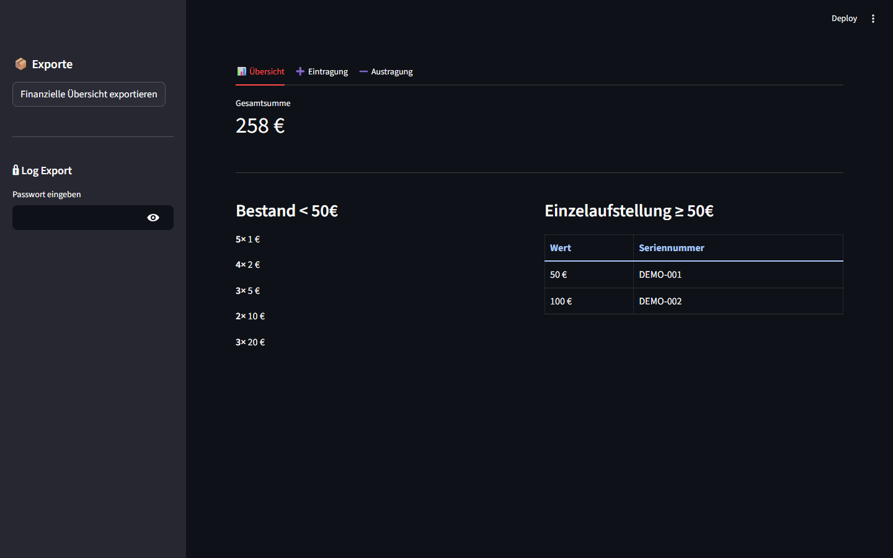
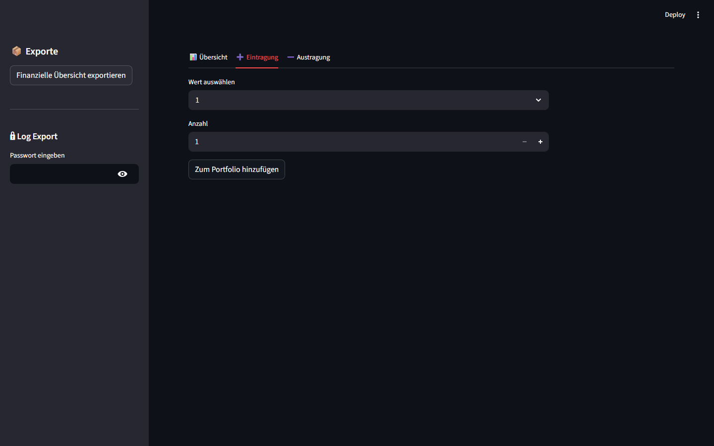
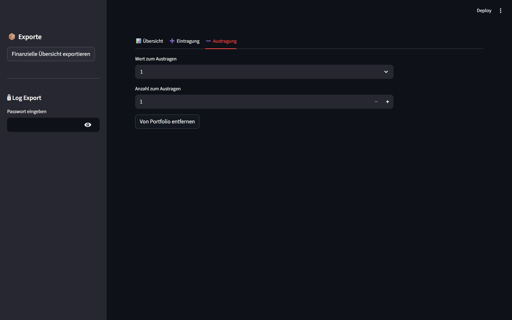

# CashTracker by JStudios

[](https://jstudios.pages.dev/projects/cashtracker/)
[](https://www.python.org/)
[](https://streamlit.io/)
[](https://jstudios.pages.dev/projects/cashtracker/)
[](LICENSE)

**Bargeldbestand nach Stückelung und Einzelnummern.**

[Projektseite](https://jstudios.pages.dev/projects/cashtracker/) · [Lizenz](LICENSE) · Bestandsprojekt

Lokale Bestandsverwaltung für Euro-Bargeld. Kleine Stückelungen werden nach Anzahl erfasst, größere Scheine einzeln mit Kennnummer. Ein- und Austragungen aktualisieren die Gesamtsumme.

## Hintergrund

CashTracker ist kein Bankkonto oder Buchhaltungsprogramm, sondern eine einfache lokale Übersicht über vorhandenes Bargeld. Die Trennung zwischen Mengenbestand und einzeln erfassten Scheinen ermöglicht eine nachvollziehbare Bestandsführung.

## Vorschau

### Bargeldübersicht



*Fiktiver Gesamtbestand mit Stückelungen und Demo-Kennnummern.*

## Funktionsumfang

### Stückelungen unter 50 €

Für 1, 2, 5, 10 und 20 € werden Anzahlen gespeichert. Die Summe entsteht aus Stückelung mal Anzahl.

### Scheine ab 50 €

50-, 100-, 200- und 500-Euro-Scheine werden einzeln mit Kennnummer erfasst. Die Austragung erfolgt über die ausgewählte Kennnummer.

### Transaktionsprotokoll

Ein- und Austragungen werden mit Zeitstempel, Aktion, Wert und gegebenenfalls Kennnummer als CSV protokolliert.

### Export

Die Übersichts-CSV enthält die kleinen Stückelungen. Der detaillierte Log-Export ist optional durch eine lokale Umgebungsvariable freischaltbar; das ist keine umfassende Authentifizierung.

## Beispiel und Bedienung

Die vollständig fiktive Vorschau enthält 108 € aus kleinen Stückelungen und 150 € aus zwei größeren Scheinen, zusammen 258 €. DEMO-001 und DEMO-002 sind frei erfundene Kennnummern; sie stammen nicht von echten Banknoten.

1. **Bestand eintragen:** Wert und Anzahl oder bei größeren Scheinen die Kennnummer angeben.
2. **Übersicht prüfen:** Gesamtsumme und Aufteilung abgleichen.
3. **Austragung erfassen:** Menge oder einen bestimmten größeren Schein entfernen. CSV-Sicherung separat aufbewahren.

### Eintragung



*Formular für Wert und Anzahl.*

### Austragung



*Formular zum Entfernen einer Stückelung.*

## Technische Eckdaten

Python · Streamlit · pandas · JSON · CSV

| Bereich | Beschreibung |
| --- | --- |
| Bestand | data/inventory.json |
| Transaktionen | data/transactions.csv |
| Kleine Stückelungen | Mengenbestand |
| Große Scheine | Einzelaufstellung mit Kennnummer |
| Log-Export | CASHTRACKER_EXPORT_PASSWORD |

## Installation unter Windows

Python und pip installieren.

```powershell
git clone https://github.com/byJStudios/cashtracker.git
cd cashtracker
python -m venv .venv
.venv\Scripts\python.exe -m pip install -r requirements.txt
.venv\Scripts\python.exe -m streamlit run app.py --server.address 127.0.0.1
```

Alternativ das Repository als ZIP herunterladen und entpacken. Die lokale Browseradresse wird von Streamlit im Terminal angezeigt. Keine realen Daten in den Repository-Ordner einchecken.

## Projektstatus, Datenschutz und Grenzen

Nur lokal betreiben. Keine Bankanbindung, kein Mehrbenutzer- oder revisionssicheres Buchhaltungssystem. Das Exportpasswort schützt nicht den Zugriff auf lokale Dateien. Persönliche Bestände, Seriennummern und Logs nicht veröffentlichen. Übersicht mit Beispieldaten getestet, nicht sämtliche Transaktions- und Fehlerfälle.

## Lizenz

Du kannst dieses Werkzeug im Rahmen der [PolyForm Noncommercial License 1.0.0](LICENSE) für die dort definierten Zwecke nutzen, den Quellcode nachvollziehen, daraus lernen und ihn entsprechend der Lizenz verändern oder weitergeben. Das Projekt ist Source-Available, nicht OSI-Open-Source. Bereits wirksam gewährte Rechte bleiben unberührt.

Drittkomponenten behalten ihre jeweiligen Lizenzen: Streamlit (Apache-2.0), pandas (BSD-3-Clause). Sie werden separat installiert; die neue Lizenz beansprucht keine Rechte an Drittsoftware, Marken oder Inhalten Dritter. JStudios-Branding und eigene Gestaltungselemente sind nicht pauschal zur Nutzung freigegeben.

Alle nicht eingeräumten Rechte bleiben den jeweiligen Rechteinhabern vorbehalten. Für eine Nutzung außerhalb der bestehenden Lizenz, etwa für nicht abgedeckte kommerzielle Zwecke, kannst du JStudios kontaktieren: [jstudios.development@gmail.com](mailto:jstudios.development@gmail.com).

© 2026 Julian Schmitz / JStudios
